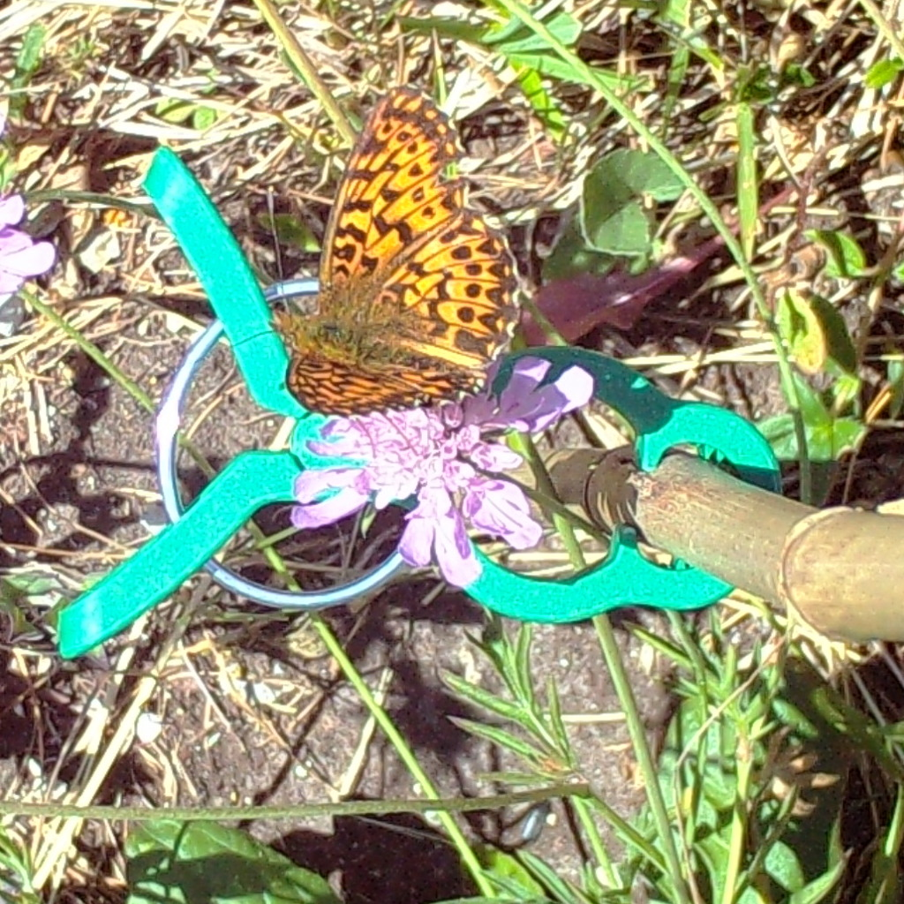

# Zero-Shot Insect Detection

[](https://www.python.org/downloads/)
[](LICENSE)

**Master's thesis project, University of Bologna, 2026, Lorenzo Girotti**

Evaluate zero-shot vision-language models (GroundingDINO, SAM3, OWL-ViT)
for detecting insects in ecological camera trap images,
compared against supervised YOLO baselines.



*An example camera-trap image from `example_dataset/`.*

---

## Table of Contents

- [Zero-Shot Insect Detection](#zero-shot-insect-detection)
  - [Table of Contents](#table-of-contents)
  - [Quick Start](#quick-start)
    - [Prerequisites](#prerequisites)
    - [Installation](#installation)
    - [First run, step by step (no prior knowledge needed)](#first-run-step-by-step-no-prior-knowledge-needed)
    - [Environment Setup](#environment-setup)
    - [Model Weights](#model-weights)
    - [Minimal Inference Example](#minimal-inference-example)
    - [Running Inference on a Dataset](#running-inference-on-a-dataset)
      - [Long runs in the background](#long-runs-in-the-background)
      - [Launcher or notebook?](#launcher-or-notebook)
    - [Hardware expectations](#hardware-expectations)
    - [Understanding the config block](#understanding-the-config-block)
    - [Evaluating a Run](#evaluating-a-run)
    - [Converting a dataset to COCO](#converting-a-dataset-to-coco)
    - [Troubleshooting](#troubleshooting)
    - [Binary Classifier (Optional)](#binary-classifier-optional)
  - [Supported Models](#supported-models)
  - [Adding a New Detector](#adding-a-new-detector)
  - [Repository Structure](#repository-structure)
    - [Where files go](#where-files-go)
  - [Citation \& License](#citation--license)

## Quick Start

### Prerequisites
- Python 3.11+
- CUDA-capable GPU (optional, CPU fallback available)
- [HuggingFace token](https://huggingface.co/settings/tokens) (required for SAM3, DINOv3)

### Installation

```bash
git clone https://github.com/lollogiro/zero-shot-insect-detection.git
cd zero-shot-insect-detection
bash scripts/setup.sh    # one-command setup: venv + dependencies + .env
```

`scripts/setup.sh` creates a Python 3.11+ virtual environment (`.venv`), installs the
pinned dependencies from `requirements.txt`, and copies `.env.example` to
`.env` if it does not exist yet. It is safe to re-run.

To open the notebooks afterwards: start JupyterLab with `python -m jupyter lab`
from the repo root, or open the `.ipynb` files in VSCode and pick the
`zero-shot-insect-detection` kernel (registered by setup).

### First run, step by step (no prior knowledge needed)

You only type two commands; everything else happens in VSCode (or the
browser):

1. **Install everything**: `bash scripts/setup.sh`. At the end it prints an
   environment check: every `[OK]` line means you are ready, `[--]` lines
   tell you exactly what is missing.
2. **Download the default model's weights** (one command, only the first
   time): `bash scripts/download_weights.sh`. Skip this if you plan to use a
   HuggingFace model instead (GroundingDINO, SAM3, OWL-ViT download
   automatically on first use).
3. **Open the notebooks**: open the repo folder in VSCode, open
   `examples/run_inference.ipynb`, and pick the *Zero-shot Insect Detection*
   kernel in the top-right corner. (Or run `python -m jupyter lab` from the
   repo root and click the file there.)
4. **Run inference on the example dataset**: click *Run All* (top menu). The
   default config runs the shipped `example_dataset/`, so there is nothing
   to edit the first time; after a few seconds you get
   `results/my_run.json`.
5. **Look at the results**: open `examples/eval.ipynb`, click *Run All*:
   mAP/mAR bars, F1-vs-confidence and FROC curves, a per-class recall table
   and annotated images. This works even if you skipped step 4 (it falls
   back to the committed SAM3 example run).
6. **Your own images**: open `run_inference.ipynb` again and edit only the
   three lines at the top of the config cell (`COCO_JSON_PATH`,
   `IMAGES_DIR`, `OUTPUT_PATH`); set `COCO_JSON_PATH = None` to run on a
   plain folder of images, no annotations needed.

Manual equivalent, if you prefer to set things up yourself:

```bash
python3 -m venv .venv
source .venv/bin/activate
pip install -r requirements.txt
cp .env.example .env
```

### Environment Setup

Edit `.env` and set `HF_TOKEN=hf_your_token_here` (required for SAM3 and
DINOv3; GroundingDINO and OWL-ViT work without it). The other variables have
working defaults.

### Model Weights

**🤗 HuggingFace models** (GroundingDINO, SAM3, OWL-ViT, DINOv3):
These download automatically on first use. To store them inside the repo:

```python
from utils.models import SAM3Detector
detector = SAM3Detector(cache_dir="./models-cache")
```

**📦 YOLO supervised baselines** (`.pt` files, manual download required):
Place these in `models-cache/` at the repo root:

```
models-cache/
├── insect1201-bestF1-1280v5m6_bjerge2023.pt   # Bjerge2023
├── yolov5_s_best_stark2023.pt                  # Stark2023
├── marin2025.pt                                # Marin2025
├── flat_bug_M.pt                               # FlatBug
└── insectsDCT_insects6ColorExtend.pt           # InsectsDCT
```

Step-by-step download instructions for every file (direct links, unzip and
rename steps) are in [MODEL_WEIGHTS.md](MODEL_WEIGHTS.md). Keep the exact file
names above: they are the defaults used in `utils/models.py`.

> The `models-cache/` directory is gitignored.

**⚖️ Binary classifier weights** (optional): download the ready-made weights
from Google Drive (4 files, ~6 MB) or train them locally via the notebooks in
`binary_classificator/`; either way they end up in
`models-cache/binary_classificator/`. Download instructions are in
[MODEL_WEIGHTS.md](MODEL_WEIGHTS.md). See also
[Binary Classifier](#binary-classifier-optional).

### Minimal Inference Example

```python
from PIL import Image
from utils.models import GroundingDINODetector

detector = GroundingDINODetector()
img = Image.open("your_image.jpg").convert("RGB")
dets = detector.predict(img, prompt=["beetle", "ant", "fly"])
for d in dets:
    print(f"{d.label}: {d.score:.2f} at {d.box}")
```

### Running Inference on a Dataset

```bash
# Edit the config block in the script, then run (from anywhere in the repo).
# Out of the box it runs on the shipped example_dataset/; edit the
# COCO_JSON_PATH / IMAGES_DIR lines to point at your own dataset:
python examples/grounding_dino.py

# Or use the unified pipeline directly in your code:
python -c "
from utils.models import GroundingDINODetector
from utils.inference import run_inference

detector = GroundingDINODetector()
run_inference(detector, coco_json_path='annotations.json', images_dir='./images/')
"
```

#### Long runs in the background

On large datasets a run can take a long time. To keep it alive after closing
the terminal, launch it with `nohup`:

```bash
nohup python examples/grounding_dino.py > run.log 2>&1 &
# the process keeps running in the background; follow its progress with:
tail -f run.log
```

The result JSON is written to `results/<model>/` as usual once the run
finishes (the logs land in `run.log` instead of the terminal).

#### Launcher or notebook?

Each model has two entry points that expose the same options, for different
jobs:

| Entry point | Use it for | Where the options live |
|---|---|---|
| `examples/run_inference.ipynb` | Batch runs over a whole dataset from a notebook, no terminal needed | The config cell in the notebook |
| `examples/*.py` launchers | Same batch runs, from a terminal | UPPER_CASE constants at the top of the script |
| `examples/*.ipynb` notebooks | Interactive experiments on a single image: visual inspection, threshold tuning | The config cell in the notebook |

The notebooks are the friendlier starting point: each step is explained in
markdown, and `examples/eval.ipynb` walks through the full evaluation of
a launcher-produced result file.

> The two config blocks are not linked: changing a constant in the launcher
> does not change the notebook, and vice versa.

### Hardware expectations

- **YOLO baselines**: CPU is enough. They are small models and the sliced
  inference keeps the tiles modest; a GPU only speeds up large datasets.
- **Zero-shot detectors** (GroundingDINO, OWL-ViT, SAM3): large foundation
  models, count on at least 8 GB VRAM. SAM3 is the heaviest and really wants
  a GPU; GroundingDINO-base and OWL-ViT-large may squeeze into less. Without
  a GPU they run, but are impractically slow beyond toy datasets.
- **Binary classifier**: the SVM/MLP heads are tiny, but the embedding
  extractors (DINOv3, BioCLIP-2.5) also prefer a GPU.

### Understanding the config block

The launchers and notebooks share the same options, named after the parameters
of `run_inference()` (see `utils/inference.py`). The ones you will actually
touch:

| Option | What it does | Typical value |
|---|---|---|
| `COCO_JSON_PATH`, `IMAGES_DIR` | Your dataset: COCO annotations JSON and image folder | shipped `example_dataset/` |
| `TARGETS` (launcher) / `targets` (notebook) | The text prompt: `P1` = just "insect", `P2` = contextual phrases, `P3` = common insect names | `PROMPTS["P3"]` |
| `CONF_THRESHOLD` (launcher) / `det_threshold` (notebook) | Minimum confidence for the detector to keep a box | 0.1 |
| `FINAL_DET_THRESHOLD` (notebook only) | Extra filter on the final combined score | 0.1-0.5 |
| `MASK_THRESHOLD` (SAM3) | Threshold that binarizes the predicted masks | 0.5-0.7 |
| `SLICE_SIZE`, `OVERLAP`, `IOU_THRESHOLD` | Advanced: tiled inference for large images and NMS fusion; `SLICE_SIZE = None` = whole image | `None` |
| `USE_BINARY_CLASSIFIER` | Re-score each box with the insect/background classifier (weights must exist) | `False` |
| `DISCRIMINATOR_MODE`, `DISCRIMINATOR_NAME` | Which trained classifier: `"svm"`/`"mlp"` and `"dinov3"`/`"bioclip2_5"` | `"mlp"` / `"dinov3"` |
| `BINARY_SCORE_MODE` | How to merge classifier score with detection score: `"joint"` multiplies them, `"mean"` averages them | `"joint"` |
| `FIXRES` | Margin around a box (fraction of its size) added before classifying the crop | 0.3 |
| `DISCRIMINATOR_FILTERING` | Drop detections with classifier score below this value; `None` = no filtering | `None` |

Rule of thumb: if a detection is missing, lower `CONF_THRESHOLD`; if there are
too many false positives, raise it, or enable the binary classifier.

**No annotations yet?** Set `COCO_JSON_PATH = None` and the pipeline scans
`IMAGES_DIR` for images instead (jpg/png, no JSON needed). Annotations are
only required to compute evaluation metrics, not to produce detections.

### Evaluating a Run

```bash
python examples/sam3.py   # writes results/sam3/example_dataset.json (committed)
```

Then open `examples/eval.ipynb` to evaluate that result against the COCO
ground truth: COCO mAP/mAR, F1-vs-confidence and FROC curves, class-aware
recall, visual inspection, prompt ensembling and per-image timings: a tutorial
on the `utils/eval_utils.py` functions. `results/` is gitignored except one
file: `results/sam3/example_dataset.json`, the SAM3 run on the example
dataset produced by the launcher, which is committed. If you have not run a
launcher yet, the notebook falls back to it, so it works out of the box.

### Converting a dataset to COCO

`dataset_conv_scripts/` contains utility notebooks used to convert datasets
in other formats to the COCO format (`csv_to_coco.ipynb`, `via_to_coco.ipynb`,
`yolo_to_coco.ipynb` for CSV, VIA and YOLO annotations), and
`filter_dataset.ipynb` to filter a dataset that is not in COCO format and
make the train/val/test splits work.

### Troubleshooting

| Symptom | Fix |
|---|---|
| `ModuleNotFoundError: No module named 'utils'` | The venv is not active: `source .venv/bin/activate` first (or run `.venv/bin/python examples/...`) |
| Gated-model errors for SAM3 / DINOv3 | Set `HF_TOKEN=hf_...` in `.env` (see scripts/setup.sh's note) |
| `Binary classifier weights not found` | `bash scripts/download_weights.sh` (or follow MODEL_WEIGHTS.md), this step can be skipped if you don't need the binary classifier |
| YOLO fails to load its `.pt` file | Weights missing or misnamed: `bash scripts/download_weights.sh --yolo`, keep the exact names from MODEL_WEIGHTS.md |
| Notebook kernel missing / imports fail in Jupyter | Re-run `bash scripts/setup.sh`: it registers the `zero-shot-insect-detection` kernel |
| "Repo root not found" in a notebook | Open the notebook from inside the repo directory |
| CUDA out of memory | Lower `SLICE_SIZE` (e.g. 512), or use a YOLO baseline on CPU |
| Everything is very slow | Zero-shot detectors need a GPU (see Hardware expectations); YOLO baselines run on CPU |
| `TypeError: unexpected keyword argument` (new detector) | A kwarg mismatch between `predict()` and `_process_tile`; see Adding a New Detector |
| "evaluating the committed SAM3 example run" in the eval notebook | Normal: it means no local run exists yet; run a launcher to evaluate your own |

### Binary Classifier (Optional)

Post-hoc *insect vs background* filter: each detection box is cropped and
embedded, and a binary classifier re-scores it to suppress false positives.

- **Training**: `binary_classificator/train_svm.ipynb` (SVM) and
  `binary_classificator/train_mlp.ipynb` (MLP). Embeddings are extracted by
  `binary_classificator/extract_embeddings.py` (BioCLIP-2.5, DINOv3).
- **Weights**: saved to `models-cache/binary_classificator/` (gitignored) as
  `insect_classifier_ecostack_{svm|mlp}_{bioclip2_5|dinov3}.{joblib|pth}`.
  Ready-made weights can be downloaded from Google Drive, see
  [MODEL_WEIGHTS.md](MODEL_WEIGHTS.md).

In the notebooks (`examples/*.ipynb`), enable it by setting
`USE_BINARY_CLASSIFIER = True` in the config cell and pick the combination with
`DISCRIMINATOR_MODE = "mlp"` (or `"svm"`) and `DISCRIMINATOR_NAME = "dinov3"`
(or `"bioclip2_5"`). The classifier is loaded only if its weights are present.
`BINARY_SCORE_MODE` chooses how the classifier score combines with the
detection score: `"joint"` (product) or `"mean"` (average).

In the launchers (`examples/*.py`), set `USE_BINARY_CLASSIFIER = True` and pick
the combination with `DISCRIMINATOR_MODE = "mlp"` (or `"svm"`) and
`DISCRIMINATOR_NAME = "dinov3"` (or `"bioclip2_5"`) in the config block (plus
the optional `FIXRES`, `DISCRIMINATOR_FILTERING` and `BINARY_SCORE_MODE`).

Programmatic API: `has_binary_classifier(mode, name)` checks weight
availability without loading, `load_binary_classifier(mode, name)` loads the
classifier (raising a helpful error if the weights are missing), and
`run_inference()` accepts `discriminator_mode`, `discriminator_name`,
`fixres`, `discriminator_filtering` and `binary_score_mode`.

---

## Supported Models

| Detector | Type | Boxes | Masks | Prompt |
|---|---|---|---|---|
| GroundingDINO | Zero-shot | ✅ | ❌ | Text |
| SAM3 | Zero-shot | ✅ | ✅ | Text |
| OWL-ViT / OWLv2 | Zero-shot | ✅ | ❌ | Text |
| YOLOv5 / YOLOv8 | Supervised | ✅ | Some | Fixed classes |

---

## Adding a New Detector

A detector is one class in `utils/models.py`; the tiling, coordinate offset,
cross-tile NMS fusion and score sorting are shared in `run_sliced_inference()`
(`utils/sliced_inference.py`), so a detector only implements two methods:

- `predict(image, prompt, **kwargs)`: assembles the text prompt and calls
  `run_sliced_inference(...)` with its own tile callback.
- `_process_tile(tile, x1, y1, **kwargs)`: runs the model on one tile and
  returns `Detection` objects whose boxes are in full-image coordinates,
  i.e. tile-local boxes offset by `(x1, y1)`.

Every extra kwarg passed to `run_sliced_inference()` is forwarded verbatim to
`_process_tile` (and `iou_threshold` is added automatically), so the
signatures must match; a mismatch raises `TypeError: unexpected keyword
argument`. Detector-specific thresholds are declared as named kwargs of
`predict()` and threaded down the chain. `slice_size=None` skips tiling and
runs the full image at once, useful while debugging a new detector.

Zero-shot (foundation) template, modeled on `GroundingDINODetector`:

```python
# from utils.models import BaseDetector, Detection, _default_cache_dir
# from utils.sliced_inference import run_sliced_inference

class MyDetector(BaseDetector):
    def __init__(self, model_name: str = "org/my-model",
                 cache_dir: str = _default_cache_dir(),
                 device: Optional[str] = None) -> None:
        super().__init__(model_name=model_name, supports_mask=False)
        self.device = device or ("cuda" if torch.cuda.is_available() else "cpu")
        # from_pretrained downloads the weights through the HF Hub API on
        # first use; see the Model Weights section above
        from transformers import AutoModelForZeroShotObjectDetection, AutoProcessor
        self.processor = AutoProcessor.from_pretrained(model_name, cache_dir=cache_dir)
        self.model = AutoModelForZeroShotObjectDetection.from_pretrained(
            model_name, cache_dir=cache_dir).to(self.device).eval()

    def _process_tile(self, tile, x1, y1, text: str, conf_threshold: float,
                      **kwargs) -> List[Detection]:
        tile_w, tile_h = tile.size
        inputs = self.processor(images=tile, text=text,
                                return_tensors="pt").to(self.device)
        outputs = self.model(**inputs)
        results = self.processor.post_process_grounded_object_detection(
            outputs, threshold=conf_threshold,
            target_sizes=[(tile_h, tile_w)])[0]
        offset = torch.tensor([x1, y1, x1, y1])
        raw: List[Detection] = []
        for box, score in zip(results["boxes"], results["scores"]):
            raw.append(Detection(
                box=(box.detach().cpu() + offset).tolist(),
                score=score.item(), label="insect"))
        return raw

    def predict(self, image, prompt, conf_threshold: float = 0.1,
                slice_size: Optional[int] = None, overlap: float = 0.2,
                iou_threshold: float = 0.5, **kwargs) -> List[Detection]:
        text = ".".join(prompt) + "."
        with torch.no_grad():
            return run_sliced_inference(
                image, slice_size, overlap, process_tile=self._process_tile,
                iou_threshold=iou_threshold, text=text,
                conf_threshold=conf_threshold,
            )
```

Notes:

- Prompt assembly is detector-specific: GroundingDINO joins phrases with
  `"."`, SAM3 with `","`, OWL wraps each in `"a photo of a ..."`. How
  `prompt` becomes model text is up to the detector.
- Supervised detectors are even simpler: subclass `YOLODetector` and set the
  default weight path and the `use_ultralytics` flag, like the five YOLO
  subclasses at the bottom of `utils/models.py`.
- Masks: pass `supports_mask=True` and fill `mask_rle`; see
  `SAM3Detector._process_tile` (full-canvas placement) or the YOLO mask path.
- There is no detector registry: instantiate the class in an `examples/*.py`
  launcher (mirroring `examples/grounding_dino.py`) and evaluate the run in a
  matching `*_eval.ipynb` notebook.
- Hub quirks are per-model, not architectural: SAM3 ships on the hub as
  `Sam3VideoModel`, so it needs `Sam3Processor` instead of `AutoProcessor`.
  Copy the closest existing detector and adjust.

---

## Repository Structure

```
├── utils/
│   ├── models.py            # BaseDetector, all detector classes, binary classifiers
│   ├── eval_utils.py        # COCO evaluation metrics, plots, FROC curves
│   ├── viz_utils.py         # Detection and mask visualisation
│   ├── inference.py         # Unified inference pipeline (run_inference)
│   └── sliced_inference.py  # Tiled inference helper for large images
├── binary_classificator/    # Embedding extraction + MLP/SVM training
├── dataset_conv_scripts/    # Notebooks: CSV/VIA/YOLO to COCO, filtering, splits
├── example_dataset/         # Tiny COCO dataset: 1 image per class + 1 empty (used by the examples by default)
├── examples/                # Notebooks + config launchers
│   ├── run_inference.ipynb  # Batch inference from a notebook (config cell)
│   ├── eval.ipynb           # Evaluate any run (reads results/<model>/*.json)
│   ├── sam3.ipynb / sam3.py                 # SAM3
│   ├── groundingdino.ipynb / grounding_dino.py  # GroundingDINO
│   ├── owl_large.ipynb      # OWLv2
│   └── yolo_models.ipynb / yolo_models.py   # YOLO baselines
├── scripts/
│   ├── setup.sh             # One-command setup (venv + deps + .env + kernel)
│   └── download_weights.sh  # Fetch YOLO / binary-classifier weights
└── pyproject.toml           # pip-installable package definition
```

### Where files go

| Directory | Contents | In git? |
|---|---|---|
| `models-cache/` | Downloaded weights (see MODEL_WEIGHTS.md) | No |
| `results/` | Run outputs: COCO-format result JSONs (large on big datasets) | No, except `results/sam3/example_dataset.json` (committed SAM3 example run, `eval.ipynb` fallback) |
| `scratch/` | Local experiments: notebooks, ad-hoc scripts | No |

`results/` and `scratch/` are gitignored by default, so everyone keeps local
experiments and large result JSONs out of the repo; the one exception is the
committed SAM3 example run (`results/sam3/example_dataset.json`), which
`eval.ipynb` falls back to. To share a specific run or experiment, add a
`!path/to/file` exception in `.gitignore`.

---

## Citation & License

MIT License. If you use this work in academic research, please cite the
thesis (link to be added after publication). The licenses of the third-party
models used by this project (GroundingDINO, SAM3, OWL-ViT, YOLO, DINOv2/v3,
BioCLIP-2/2.5, EUPE) are listed in [LICENSE](LICENSE).

---

*Maintained as part of a master's thesis at the University of Bologna.*
